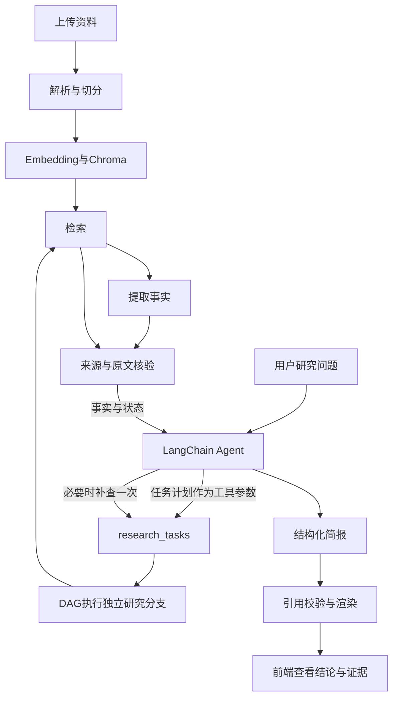

# SA-agent · AI 行业研究助手

基于用户提供的AI行业资料，组织研究任务、收集证据并生成可追溯的简报。
这是用于学习、演示和工程能力验证的研究Agent原型，不是实时行业数据库或投资建议系统。

## 研究范围与资料准备

主要面向AI技术与产品、企业应用落地、产业发展信息、风险与治理。
建议第一批资料聚焦 **企业AI应用落地与治理**，先建立一个可以核对答案的小型资料库。

适合上传：

- 有明确机构、标题、发布日期的行业或专题报告。
- 厂商发布的产品说明、技术文档、模型卡或应用指南。
- 描述具体场景、部署条件、效果与局限的应用案例。
- 有明确来源和版本的风险治理、数据管理或政策标准资料。

优先选择正文可提取的文件，保留原始出处。厂商宣称、作者观点和历史数据不自动成为客观或最新事实。
项目现有两份TXT是自编链路测试资料，不代表真实行业覆盖。
具体选材数量、文件组织与提问示例见 [资料准备指南](docs/data-guide.md)。

领域定位由页面和提示词约定；上传接口校验格式与文件名，不自动判断文档是否属于AI行业。

## 已实现

- 上传TXT、Markdown、DOCX和文本PDF；文档列表、实际片段数、导入状态和失败重试。
- 文本切分、Embedding、Chroma持久化与语义检索。
- 使用LangChain `create_agent`，由模型组织任务、调用研究工具并决定是否补查。
- 研究工具内部通过自定义DAG执行检索、事实提取、来源核验，独立分支可并行。
- 程序限制最多两次研究调用；首轮最多三个任务，补查最多两个。
- 每个子任务最多提取8条关键事实；多任务累计证据数可能大于8。模型超限时该分支明确失败，不静默截断或自动重试。
- 默认简报最多8条核心结论，提示模型合并重复观点并保留多来源引用；完整证据库仍保留。超限简报明确报错，不自动截断；语义去重效果仍需人工复核。
- 生成概述、结论、资料缺口；为核验事实分配证据编号，并检查结论引用存在性。
- 前端展示等待与错误、简报、证据原文和完成后的执行记录。

## 架构



Agent决定研究什么及是否继续；研究工具保证检索、提取和核验步骤；DAG管理依赖、状态、并行与失败传播。
线性依赖不能并行，只有独立分支可并行。目前没有并行加速率的测量结果。

## 技术栈

Python 3.11、uv、FastAPI/Uvicorn、Pydantic/Pydantic Settings、LangChain、Chroma、
`ThreadPoolExecutor`、pypdf、python-docx、python-multipart、pytest/httpx，以及原生HTML/CSS/JavaScript。

## 本地启动

在项目根目录使用Python 3.11和uv：

```powershell
uv sync
```

新环境且尚无`.env`时，复制`.env.example`为`.env`，填写：

```dotenv
API_KEY=你的模型服务密钥
BASE_URL=现有模型服务的OpenAI兼容地址
MODEL_NAME=支持工具调用的聊天模型名称
EMBEDDING_MODEL=向量模型名称
```

已有配置不要覆盖。项目使用现有服务配置，仓库不包含密钥。
聊天模型需要支持工具调用；改变已有库的Embedding模型或维度通常需要重新建立相匹配的向量库，不能直接混用。

```powershell
uv run uvicorn sa_agent.main:app --reload
```

- 工作台：[http://127.0.0.1:8000/](http://127.0.0.1:8000/)
- API文档：[http://127.0.0.1:8000/docs](http://127.0.0.1:8000/docs)

从项目根目录启动，配置、文档和向量库使用相对路径。前端由FastAPI托管，无需单独的前端服务或构建命令。

## 演示流程

1. 打开“文档库”，上传同一研究主题的资料，等待“已导入”并检查片段数。
2. 提出一个文件中确实有依据的问题，例如“根据这些资料，企业部署AI应用需要哪些条件，有哪些风险控制措施？”
3. 等待结果，检查概述与结论；点击`[E编号]`对照原文。
4. 查看执行记录中的任务、查询与节点状态。PDF来源有页码，DOCX使用片段编号而非Word页码。
5. 提出一个确定不在所上传资料中的问题，检查是否明确说明缺口，而不是编造数据。

请求可能持续数分钟；当前不展示实时节点进度。刷新页面不保留研究结果，但原文件、导入状态和向量库会保留。
上传调用Embedding，研究调用Embedding和聊天模型，可能消耗模型额度。

也可以运行手动入口：

```powershell
uv run python demo_agent.py --output outputs/my_research.json
```

按终端提示输入问题，完整结果保存为UTF-8 JSON。

## API

| 接口 | 用途 |
|---|---|
| GET `/health` | 服务健康检查，不验证远程模型可用性 |
| GET `/documents` | 本地资料、实际片段数和状态 |
| POST `/documents/upload` | multipart字段`file`，上传并同步导入 |
| POST `/documents/retry` | JSON `filename`，重新导入已有文件 |
| POST `/documents/ingest` | 兼容原有TXT文件名导入 |
| POST `/ask` | 基础RAG问答 |
| POST `/research` | 固定检索→提取→核验工作流 |
| POST `/agent/research` | 模型组织研究和补查，返回结构化简报 |

Agent请求示例：

```json
{"question":"根据资料，企业应用人工智能有哪些风险和治理措施？","k":3}
```

返回包含`question`、`answer`、`report`、`evidence`、`tasks`、`trace`。
`k`表示每个子任务检索的片段数，范围1～10，不是研究轮数。

## 测试

```powershell
uv run pytest -m "not integration"
uv run pytest tests/test_agent.py tests/test_documents.py tests/test_docx.py -v
```

普通测试使用模拟模型/向量，部分用真实本地Chroma验证存储。
真实集成测试会调用模型服务：

```powershell
uv run pytest -m integration -v
```

部分集成测试依赖已导入的本地资料；缺少前置条件时可能跳过。
资料不足测试依赖特定资料集，扩充资料后必须重新核对负例，不以原测试结果代表新资料库质量。
测试通过不等于研究结论准确率，真实资料评测与人工语义复核仍待补充。

## 主要目录

```text
src/sa_agent/
  main.py          # API和前端托管
  documents.py     # 上传、状态、列表与重试
  schemas.py       # 工具任务与计划结构
  retrieval/       # 解析、切分、入库、检索和基础问答
  skills/          # 检索、提取、来源核验、简报
  workflows/       # 框架Agent、任务执行、DAG和固定研究流程
  static/          # 单页工作台
tests/             # 普通和真实集成测试
data/documents/    # 原文资料
data/chroma/       # 本地向量库（不提交）
docs/              # 接入说明、验收记录、资料指南与后续计划
```

## 已知限制

- 来源匹配和引用存在性检查不保证语义真实性，需人工判断证据是否支持结论。
- 不联网；没有资料中的依据时，不应生成市场数据、企业能力或政策要求。
- 提示词要求保留日期、口径和观点归属，但未实现自动时效验证或专门的冲突消解模块。
- 单文件10 MB；文本PDF最多200页；不支持OCR、旧式DOC和加密文件，复杂表格与版面可能提取不完整。
- 同名文件不覆盖；没有完整版本管理或前端删除功能。入库非事务级原子更新。
- 面向本地单进程使用；无权限隔离、任务恢复或生产部署验收。
- 模型可能扩大范围、提取遗漏或产生格式错误；目前格式与引用错误直接报错，不自动修复。
- 已有真实链路案例通过，但真实资料评测规模有限；没有生产级质量或性能承诺。

更多说明：[文档接入](docs/documents.md)、[前端验收](docs/frontend.md)、[后端验收](docs/acceptance.md)、[后续计划](docs/next-steps.md)。
